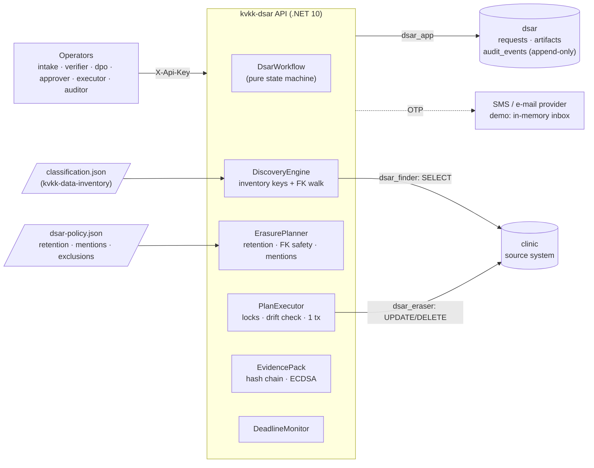

# kvkk-dsar

[](https://github.com/hekimcan206/kvkk-dsar/actions/workflows/ci.yml)
[](https://github.com/hekimcan206/kvkk-dsar/actions/workflows/codeql.yml)


[](LICENSE)

A **KVKK data-subject request (DSAR) workflow** for .NET 10 and PostgreSQL: verify who is asking, find everything a
system holds about them through the personal-data inventory, track the 30-day legal deadline, erase or anonymise what
may go and keep what the law requires, and hand over a signed evidence pack that proves it.

> **All data is synthetic; there is no real personal or health data in this repository.** TCKNs are random numbers
> with valid check digits. Retention periods and legal bases in the sample policy are illustrative, not legal advice.

## Problem

**KVKK** (*Kişisel Verilerin Korunması Kanunu*, Law No. 6698, Türkiye's counterpart of the GDPR) gives everyone the
right to ask a data controller whether it processes their data, to get it, and to have it erased (Art. 11). The
controller must answer **in writing within 30 days** (Art. 13); the subject can complain to the Personal Data
Protection Board within 30 days of the answer and 60 days of the application (Art. 14). Erasure must follow the
*Regulation on Erasure, Destruction or Anonymisation*, and every erasure must be recorded and the record kept for at
least three years.

In practice a request arrives as an e-mail, someone searches two systems by TCKN, misses the portal account that is
keyed by an e-mail in capital letters and the appointments that only carry a patient id, deletes rows by hand, and
keeps no proof. Done naively, it is also dangerous: an impostor can have someone's records destroyed, an emergency
contact's request can delete an employee's file, and deleting a patient breaks the invoices the tax law requires.

## What it does

| Step | How |
|---|---|
| **Intake** | Channels of the application communiqué (written, KEP, e-signature, mobile signature, registered e-mail, web portal); TCKN check digits, canonical phone/e-mail; reference `DSAR-2026-000123`; identifiers sealed with AES-256-GCM |
| **Verify identity** | Assurance per request type (erasure: high, access: substantial). Qualified channels count on their own; otherwise a one-time code to a phone or e-mail **already on file** for that TCKN, plus a birth-date match. Five attempts, then manual review ([ADR 0005](docs/adr/0005-proportionate-identity-verification.md)) |
| **Find the data** | Reads the **kvkk-data-inventory** `classification.json` to know which columns are identifiers and which hold personal data, then walks declared foreign keys from the rows found. Owner vs *mention* (an emergency contact, a phone in someone else's note). Searches only identifiers verification bound to the person ([ADR 0001](docs/adr/0001-inventory-driven-discovery-with-bound-identifiers.md)) |
| **Track the deadline** | 30 days in Türkiye local time, receipt day not counted, strict by default, optional roll past weekends and the 2025-2027 holidays; at-risk at 7 days, overdue after; metric of open requests by stage ([ADR 0002](docs/adr/0002-thirty-day-deadline.md)) |
| **Plan** | Per row: erase, anonymise, retain (legal basis + release date, unneeded columns still cleared) or redact a mention; a row that kept rows reference is anonymised, not deleted; recipients to notify (Art. 11(1)(f)); SHA-256 plan hash ([ADR 0003](docs/adr/0003-erasure-plan-retention-first-one-transaction.md)) |
| **Approve** | A second person approves exactly that hash; the planner cannot |
| **Execute** | As an UPDATE/DELETE-only role, one transaction per source: row locks, re-discovery inside the transaction (drift = roll back, re-plan), row-count check per statement, post-check for residual data; resumable after a crash; one executor at a time |
| **Answer** | Access export generated on demand and never stored (only its hash); answer letter in Turkish and English with what was found, erased, anonymised, kept and why, who was notified, and the complaint window; identifiers purged |
| **Prove** | Per-request hash-chained audit log (append-only even for the table owner) and a ZIP evidence pack with an ECDSA P-256 signed manifest, verifiable offline ([ADR 0004](docs/adr/0004-signed-evidence-pack-and-minimisation.md)) |

## Architecture



```mermaid
sequenceDiagram
    participant S as Data subject
    participant I as Intake
    participant V as Verifier
    participant D as DPO
    participant A as Approver
    participant X as Executor
    participant DB as Source DB
    S->>I: application (TCKN, phone, e-mail)
    I->>I: register, due date = received + 30 days
    V->>DB: contacts on file for the TCKN
    V->>S: one-time code to the phone ON FILE
    S->>V: code (+ birth date matches) → assurance High
    D->>DB: discovery: keys from the inventory, then foreign keys
    D->>D: plan per row (retain / anonymise / erase / redact mention), hash H
    A->>A: approve H (≠ planner)
    X->>DB: BEGIN; lock rows; re-discover = plan? ; UPDATE…; DELETE children→parents; COMMIT
    X->>DB: post-check: only kept rows remain
    D->>S: written answer (TR/EN) + export; identifiers purged
    D-->>D: signed evidence pack (kept ≥ 3 years)
```

## Why this design

- **The inventory is the map.** kvkk-data-inventory already classifies every personal-data column for the VERBİS
  register; reusing its `classification.json` keeps one source of truth, so the register and the DSAR answers are
  wrong (or right) in the same reviewable way. Its false positives are rejected in the policy, not in code.
- **Foreign keys find most of the data.** On the synthetic clinic, rows reachable only through a foreign key (an
  appointment carries a patient id, not a TCKN) are 81 % of a person's rows; without the walk recall drops to 0.187.
- **Mentions are not ownership.** Treating the emergency-contact phone as an owner key would hand an employee's
  personnel file to whoever is their emergency contact: 1,399 of 5,000 people would have someone else's rows planned.
- **Search only what was proven.** An e-mail typed into the form that is not on file for the verified person is
  ignored; otherwise anyone could verify with their own phone and pull a stranger's account into their export.
- **Retention before erasure, anonymise before breaking references.** The answer tells the subject which part was
  refused and until when, which is what Art. 13 and the Erasure Regulation require.
- **Approve a hash, execute in one transaction, re-check first.** The approver approved a set of rows; if the source
  changed since, the executor rolls back rather than erase something nobody reviewed. A failure leaves nothing half done.
- **Evidence without hoarding.** Identifiers are purged on close, the export is never stored, the pack holds row
  addresses and keyed fingerprints; the hash chain and signature make it checkable by an outsider.

## Quick start

```bash
docker compose up        # PostgreSQL 17, migrations, 2,000 synthetic people, the API, and the end-to-end demo
```

The `demo` container runs one access + erasure request through every step and exits 0 only if every check holds:

```text
registered DSAR-2026-000001 (01a1d542-2717-79ce-9d55-9e53ba8401fc), due 2026-12-13, required assurance High
one-time code sent to ******0513
discovery: {"customers":1,"faturalar":2,"hastalar":1,"randevular":3,"receteler":2,"tanilar":1} mentions=1
plan 83a84cb3d96706e176c45206673293b2947cf312811187ec6ca845c32ec6a264: {"Erase":4,"Anonymise":1,"Retain":5,"RedactMention":1}
self-approval by the planner: HTTP 409 (four eyes)
access export: 7572 bytes, sha256 477a5dfd27daa6534103d1a9cc8f743f8eaa3ebfd9ee5c0cab43ec02b5f5f363 (only the hash is stored)
executed: deleted 4, updated 2, unexpected residual "unexpected":[]
evidence: 10275 bytes, 10 files, key 1e7391657531f5b4; tampered copy: plan-clinic.json: content does not match the manifest hash
…
- **Erased:** customers (1), faturalar (2), randevular (1).
- **Anonymised** (personal-data fields cleared, the record remains for statistics): hastalar (1).
- **Kept:** randevular (2), receteler (2), tanilar (1).
- **Your details removed from other people's records:** randevular (1).
…
{"demo":"kvkk-dsar","reference":"DSAR-2026-000001","status":"Responded","selfApproval":409,"evidenceValid":true,"tamperDetected":true,"failures":[]}
```

Then explore at <http://localhost:58762/scalar> (demo API keys `demo-intake-key`, `demo-verifier-key`, `demo-dpo-key`,
`demo-dpo2-key`, `demo-legal-key`, `demo-ops-key`, `demo-audit-key`), or:

```bash
H='X-Api-Key: demo-dpo-key'
curl -s -H "$H" localhost:58762/api/v1/requests?open=false            # requests by deadline
curl -s -H "$H" localhost:58762/api/v1/sources/clinic/search-plan     # which inventory columns are searched, and how
curl -s -H "$H" localhost:58762/api/v1/sources/clinic/index-advice    # discovery queries that would scan whole tables
curl -s -H "$H" localhost:58762/api/v1/deadlines                      # open requests by deadline stage
```

Re-run the demo after restoring the synthetic data: `docker compose run --rm seed && docker compose run --rm demo`.

## Results

Measured on a laptop (Intel Core, family 6 model 186, 16 logical cores, Windows 11, Docker Desktop with a 7.6 GB VM
shared with another project's containers); PostgreSQL limited to 2 CPUs and 2 GiB. Method and raw numbers:
[docs/benchmarks.md](docs/benchmarks.md).

| Metric | Result |
|---|---|
| Owned-row recall on 5,000 synthetic people: full / without FK walk / raw strings / naive | 1.000 / 0.187 / 0.973 / 0.180 |
| People whose plan would include someone else's rows if mentions counted as ownership | 1,399 of 5,000 (full mode: 0) |
| Discovery median, 100,000 people (586 k rows), before → after index advice | 1,871 ms → **51.0 ms** |
| Discovery median, 10,000 people (59 k rows), before → after | 195 ms → 46.5 ms |
| Discover + plan + execute (one transaction, drift-checked), 100,000 people, before → after | 4,597 ms → **107 ms** |
| Whole erasure request over HTTP (intake → OTP → discovery → plan → approval → execution → letter), compose, 2,000 people | **449 ms** median, p95 604 ms |
| Evidence pack (15 rows, 20 audit events): build + sign / verify | 0.93 ms / 1.39 ms, 4.6 KB |
| Racing executors on one plan / parallel `execute` calls | applied exactly once / 1 × 200, 3 × 409 |
| Failure before commit | every row checksum unchanged |

Tests: **111** — 91 unit / property / golden tests (TCKN and phone properties, deadline golden
cases and a 1,000-case deadline property, a 2,000-sequence workflow property that no command order bypasses
verification, discovery, four eyes or export-first; discovery equals the ground truth for 600 people; planner
referential-safety property; evidence tamper cases; golden answer letters) and 20 Testcontainers
integration tests on PostgreSQL 17 (least privilege, SQL = in-memory discovery for 400 people in two modes, executor
isolation / drift / rollback / racing, the HTTP workflow end to end, bound identifiers, OTP lockout, parallel and
resumed execution, deadline monitor).

## Limitations and next steps

- **Accuracy is measured on a synthetic schema the author wrote**, with links the rules know about; the 1.0 recall of
  the full mode is a property of the generator, not a promise for legacy systems. The ablations are the useful part.
- Only **declared, single-column** foreign keys and single-column primary keys are used. Undeclared relationships are
  invisible; inventory tables nobody can reach are reported (here `audit_log`, keyed by user name) but not searched.
- **Anonymisation is per row**: direct identifiers are cleared; re-identification risk across the remaining attributes
  (k-anonymity / l-diversity, as the Board's anonymisation guide asks) is not assessed. An "anonymised" patient file
  under kept invoices is closer to pseudonymised data.
- No distributed transaction across sources: each source commits on its own, a crash is resumed by re-running execute.
- Qualified signatures and KEP messages are checked by a person and only recorded; certificates are not validated.
  OTP delivery is an interface; the demo inbox must never be enabled in production. Operators use API keys (OIDC would
  replace them); the evidence key comes from configuration (no KMS / rotation); without it packs use an ephemeral key.
- Bound identifiers are deliberately strict: a portal account that shares no contact with a record carrying the
  verified TCKN is not found, even for a qualified-signature application. The letter then reports only what was
  searched; a second verification of that e-mail or phone (not implemented) would be the way to include it.
- Rectification, objection and compensation are tracked against the deadline but decided and carried out by people.
- The holiday table covers 2025-2027 (needed only for the opt-in rolling deadline policy).
- PostgreSQL only; an Oracle source would need its own reader and executor (kvkk-data-inventory already has the catalog side).
- Periodic destruction of retained rows when their period ends is not implemented; the plan records the release dates.

## KVKK / privacy note

All data in this repository, its tests, samples and benchmarks is synthetic. The workflow database keeps identifiers
of open requests sealed and purges them on close; discovery results are row addresses; access exports are never
stored. The sample policy's retention periods and legal bases are illustrative and are not legal advice. See the
[threat model](docs/threat-model.md).

## License

[MIT](LICENSE)
